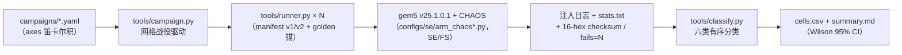

# gem5-fi-fuzz

**从生产级故障取证走向微架构级故障注入**——面向 ARM64 服务器 CPU 静默数据损坏（SDC）的 gem5 仿真研究基础设施。

一台鲲鹏 920 服务器（192 核 TaiShan-v110）的 CPU179 核在 22 天里引发了 19 次致命 panic，全部归因于该核 LSU 数据返回通路的静默数据损坏（SDC）。本仓库先用 crash 取证把故障钉死到微架构通路（D1 数据通路 / D2 地址通路 / D3 PTW 通路），再在 gem5 v25.1.0.1 + CHAOS 框架上构建了 **19 个微架构故障注入器**与可 campaign 化跑批的实验基础设施，用周期精确仿真定量回答**"哪个单元、什么故障形态、多大几率产生 SDC"**，产出 **DFT 测试向量、保护投资排序、位谱指纹** 三类可交付结论，并进一步用于评估 SDC 检测工具（SDCShield）与检测度量（SDC-ED、Harpocrates 覆盖指标）的有效性。

> 新读者入口：[`docs/gem5/project-understanding.md`](docs/gem5/project-understanding.md)（全景技术文档）；
> 结果与任务登记簿：[`findings.md`](findings.md) / [`task_plan.md`](task_plan.md) / [`AGENT_TASKS.md`](AGENT_TASKS.md) / [`progress.md`](progress.md)。

## 解决的问题

| 问题 | 本仓库的回答方式 |
|---|---|
| 生产 panic 的微架构根因是什么 | 19 份 vmcore 七要素取证（寄存器代数闭合 + 内存真值对照 + 四族坏值形态学），穷举证伪单比特翻转模型，定位 D1/D2/D3 三条共址通路（`docs/cases/`） |
| 哪个微架构单元、什么故障形态、多大几率产生 SDC | 19 个注入器 × formal 战役（n=384 seeds + 5% replay 校验），六类有序分类 + Wilson 95% CI |
| 有限的保护预算（ECC / 校验）该投到哪里 | occupancy 加权保护投资排序：l1d > l1d_fwd > lsq_fwd ≫ physreg；"取指 vs 取数悬崖"单条证据 |
| SDC 检测工具/度量到底能检出多少 | SDCShield 双通道内核的 gem5 SE 注入评估；Harpocrates 两论文复现与三方对照；SDC-ED 度量正面对比 |
| 生产环境 SDC 故障如何诊断 | openEuler vmcore/journalctl 解析 + ARM64 ESR 解码 + 版本化规则库（`rules/flight-rules.md`）+ 位谱指纹库联动 |

## 总体架构



## 核心功能

### 1. 微架构故障注入器（19 个，均为真实源码钩子）

基座是 gem5 v25.1.0.1（stable，基线 commit `62c7bf28`，见 [`CHAOS/gem5_base_version.md`](CHAOS/gem5_base_version.md)）+ 上游开源 CHAOS 故障注入框架（CHAOSReg / CHAOSPhysReg / CHAOSCache / CHAOSMem 四模块，位级故障）。本仓的核心增量是**结构化故障注入**——能表达"整字错路由"而不仅是位翻转：

| 注入器 | 目标单元 | 代表故障模式 |
|---|---|---|
| **CHAOSPhysReg** | O3 物理寄存器堆 | phys / arch_frontend / arch_commit 三种抽象；向量寄存器按 8/16/32/64-bit 通道注入；read-trace 闭环 |
| **CHAOSRenameMap** | 重命名映射表（RAT） | map_bitflip / f5_substitute（合法域替换）/ f4_field_stuck |
| **CHAOSFreeList** | 空闲表 | mark_free / pop_wrong |
| **CHAOSROB** | 重排序缓冲 | entry_bitflip / exc_suppress（异常抑制：DUE→SDC）/ spec_leak（squash 不回滚） |
| **CHAOSIQ** | 发射队列唤醒 | wake_omit / wake_phase / src_ready_bitflip |
| **CHAOSLSQFwd** | store→load 转发数据通路 | byte_lane_skew（整字节通道旋转，D1 签名复现）/ all_zero / fwd_source_sub（错源整字）/ stale_line_replay |
| **CHAOSL1DForward** | L1D 命中数据 post-ECC 通路 | ECC 后通路破坏（保护盲区） |
| **CHAOSAddrPath** | AGU 地址通路 | vaddr byte7 强制清零（D2 复现） |
| **CHAOSExec / CHAOSFPU** | 整数 / 浮点写回 | 位段注入（low/mid/high；sign/exp/mantissa） |
| **CHAOSBPU / CHAOSRAS** | 分支预测 / 返回地址栈 | target_sub / direction_flip；RAS 上报抑制 |
| **CHAOSCache** | L1D / L1I / L2 cache 行 | 数据 + 字段级（tag/valid/dirty/repl/coh/victim/opcode…）+ protection_model（SED / SECDED / secded_poison / parity_interleaved） |
| **CHAOSMem** | DRAM | 字节翻转 + addr_map_sub（地址映射故障）+ ECC 逻辑故障 |
| **CHAOSArmTLB** | D-TLB / i-TLB 表项 | pfn 位翻转 / pfn_to_mapped_page（活页替换→静默 SDC）+ parity_interleaved |
| **CHAOSPTW** | ARM 页表走查器 | PTE 翻转 / clearValidBit（绕过 ECC） |
| **CHAOSArmSysReg** | 系统寄存器 MRS 读 | 白名单合法值替换 |
| **CHAOSReg / CHAOSExMon** | 架构寄存器 / LL/SC 独占监视器 | 上游位级故障 / stxr 强制失败与成功 |

vendored 源码树另有三个扩展类：**CHAOSFUPerm**（FU 执行级永久故障）、**CHAOSGateFU**（门级网表 stuck-at，Kogge-Stone 加法器 / 阵列乘法器）、**CHAOSCov**（Harpocrates 覆盖率插桩，非注入器）。

已知边界（诚实登记）：CHAOSBPU 需 decoupledFrontEnd，与 stdlib board 组合当前不可用；CHAOSExMon 的 stale_reservation 模式需多核场景（deferred）；AddrPath / PTW / ArmTLB / ArmSysReg 在 SE 模式不触发（见[诚实边界](#诚实边界)）。

### 2. SE / FS 双模式仿真配置（`configs/se/`）

- **`arm_chaos.py`** — SE 主配置：stdlib SimpleBoard + PrivateL1PrivateL2（64K/64K/512K）+ DDR3_1600，默认 O3 CPU（可选 Timing/Atomic/Minor）；15 个 `--chaos_*` 臂 + 全部注入参数（`--fault_type/--fault_mask/--first_clock/--max_faults/--rng_seed`…）；`--kp920_proxy` 将 O3 窗口参数对齐 TaiShan v110（ROB 128 / PhysInt 160 / PhysFloat 192 / LQ 48 / SQ 42 / 宽 4 / 2.6GHz）；`--sve_vl` / `--sme_vl` 支持 128/256/512/1024-bit 全规格。
- **`arm_chaos_cache.py`** — cache 注入专用（`--target l1d/l1i/l2` × `--target_field data/tag/valid/…` × `--protection_model`）。
- **`arm_chaos_fs.py`** — 全 boot FS 模式（ARM Ubuntu 磁盘 + 真内核）。
- **`fs_checkpoint.py`** — FS 两阶段流水线：boot 存 checkpoint（一次性，约 890 s）→ inject 恢复注入（每 run 约 13 s）。
- **`configs/cpu-profiles/`** — TaiShan-v110 / Kunpeng920 / Neoverse-N2 CPU 描述 YAML，描述驱动的实例化入口 `profile_taishan.py`。

### 3. campaign 化实验基础设施（`tools/`）

- **`runner.py`** — 单次注入的诚实基线：manifest schema 校验 + 二进制 sha256 → 参数映射 → 跑一次 gem5 → 注入日志计数断言 → 分类，输出一行 `RESULT`。
- **`campaign.py`** — 网格战役驱动：campaign YAML 的 axes 笛卡尔积 → 每 cell N 个种子并行跑批 → `cells.csv` + `summary.md`（Wilson 95% CI）。formal 规模统一 n=384 + 5% replay 校验，配 golden 校验和注册表防工具回归。
- **`classify.py`** — 六类有序互斥分类：`SimulatorError → Hang → Crash → Inactive → Masked → SDC`；v2 九类 ECC 扩展（Corrected / DetectedContained / Latent）。
- **分析链**：`escape_decomp.py`（SDC 逃逸机理分解）、`fisher_test.py`（精确检验）、`report.py`（跨战役合并）、`sdc_fingerprint.py` + `loo_validate.py`（位谱指纹库与留一法验证）、`ed_profile/ed_score/ed_select.py`（SDC-ED 评分与次模序列选择）、`harp_*.py`（Harpocrates 包装 / 评估 / 进化资产）。

### 4. 生产故障诊断引擎（`tools/diag/` + `rules/`）

ARM64 ESR EC/FSC 解码、openEuler vmcore-dmesg / journalctl / messages 解析、P1–P11 正规则 + N1–N10 排除规则的七步法诊断（HIGH/MEDIUM/LOW/EXCLUDED 置信度分级），规则库版本化于 [`rules/flight-rules.md`](rules/flight-rules.md) 并用本仓 formal 实验先验回填。core179 六案回放达 HIGH 置信度。

### 5. SDC-ED 度量与 Harpocrates 资产

- **SDC-ED**：`ED(S) = Σ_u w_u·ρ_u·q_u·A_u(S)`（w=位占比、ρ=SDC 转化率、q=checker 可观测性、A=激活覆盖），CPU 描述 YAML 驱动，七维覆盖单元分解（`docs/sdc-ed/method.md`）。
- **Harpocrates 复现**：对 ISCA'24 Harpocrates 与 IEEE Micro'26 Harpocrates++ 两篇论文的覆盖指标 / advice 进化 / 检测能力实验做 ArmO3 SE 复现与三方对照（`docs/harpocrates/`）。

### 6. SVE / SME 全规格评估（`workloads/sdcshield/`）

四个双通道内核（`fpu_special_sve_dual` / `stencil_axis_dual` / `sme_fmopa_dual` / `sme_za_tileview_dual`）：通道 A 做运行时标量参考逐位比对（`SDCSHIELD_FAILS=<n>`），通道 B 做 FNV-1a 全状态 checksum（主 FI oracle）；fixed / random 双输入模式；配合 `--sve_vl/--sme_vl` 覆盖 128–1024-bit 四档。含 gem5 SVE/SME 语义保真度探针（`sve_sme_semantics.c`，F3/F4 偏差登记与规避）。

### 7. DFT 测试向量（`dft/`）

method1/2/3 定向 kernel + 注入器配置 + 健康/次品签名对照打包为 5 个筛查向量（`dft/manifest.yaml` + `run_all.sh`），直接驱动 CHAOS 构建的 gem5 二进制比对签名。

## 特性

1. **结构化故障模型**：在位翻转 / stuck-at 之上，表达整字错路由（字节通道旋转、错源整字）、合法域替换（RAT 合法 tag、TLB 活页、SysReg 白名单值——错误值全程合法，任何位级 ECC 放行）、相位偏移、ECC 后通路破坏。
2. **read-trace 闭环**：`reads_before_overwrite` 诊断把"故障值被读几次才被覆盖"钉死，关闭"故障是否真的传播"这一架构级注入器无法回答的问题（H1：P(SDC|reads>0)=1.0000，reads 中位 1,975,000）。
3. **统计纪律**：六类有序互斥分类（先排仿真器自身错误，防止工具 bug 伪装成科学发现）+ Wilson 95% CI + n=384 formal 标准 + golden replay。
4. **预注册假设体系**：H0–H8（机理假设）、J1–J4（SDCShield 评估判据）、J1'–J3'（SVE/SME 判据）——每条判据先注册后裁决，阴性结果如实入档。
5. **种子级可复现**：manifest v1/v2 JSON schema（24 个组件枚举、触发窗口、RNG 种子、sha256 锚），同种子字节一致重放。
6. **诚实边界制度**：每份报告带 Honesty note；工具正确性审计本身是方法论的一部分（见[诚实边界](#诚实边界)）。

## 快速开始

### 0. 前置

aarch64 Linux 主机（本仓在 openEuler 24.03 SP3 aarch64 / 鲲鹏 920 上开发验证）+ gem5 构建依赖（Python3 / scons / C++17 工具链等）。子模块按需初始化：

```bash
git submodule update --init   # sdcshield（被评估对象）；gem5-fs 仅 FS 模式需要
```

### 1. 构建 gem5（含全部 CHAOS 注入器）

```bash
scons -C CHAOS/gem5 build/ARM/gem5.opt -j16
```

两个已登记的工程陷阱：`scons -C` 产物落在**仓库根** `build/ARM/gem5.opt`，须拷回 `CHAOS/gem5/build/ARM/`（否则 runner 用到陈旧二进制，历史上造成过"注入不生效"假象）；`-j16` 为本机并行上限，且 campaign 跑批与构建绝不并行。

### 2. 验证注入器完整性与 golden 锚（任何注入实验前的强制前置）

```bash
bash tools/verify_gem5_injectors.sh
```

该脚本用 `nm` 检查 gem5.opt 携带完整 19 注入器类，并跑 reg_chain golden 锚（期望 `f247ef3fe6f02cfd`）与 SVE/SME 探针。本机曾出现过只含 7 个 CHAOS 类的陈旧二进制——不跑此检查可能把陈旧构建误当实验结论。

### 3. 单次注入（manifest 驱动）

```bash
python3 tools/runner.py manifests/p1-gpr-regchain-000384.yaml \
    --binary workloads/directed/reg_chain
```

### 4. 网格战役

```bash
python3 tools/campaign.py campaigns/prf-x3-bitscan-pilot.yaml \
    --binary workloads/directed/reg_chain --workload-golden f247ef3fe6f02cfd \
    --n-per-cell 16 --jobs 4 --artifacts artifacts/prf-pilot
```

### 5. 裸 gem5 单臂手工实验

```bash
CHAOS/gem5/build/ARM/gem5.opt --quiet --outdir=/tmp/od1 configs/se/arm_chaos.py \
    --cmd workloads/directed/reg_chain --cpu O3 \
    --chaos_phys --phys_mode arch_frontend --phys_target_arch=3 \
    --fault_type bit_flip --fault_mask 1 --bits_to_change 1 \
    --first_clock 100000 --max_faults 1 --rng_seed 20260825
```

### 6. FS 模式（TLB / PTW / SysReg 等 FS-only 位点）

```bash
# 两阶段流水线（boot 存 checkpoint 一次性约 890 s；inject 每 run 约 13 s）：
CHAOS/gem5/build/ARM/gem5.opt configs/se/fs_checkpoint.py \
    --phase=inject --ckpt-dir=cpts/base \
    --kernel=gem5-fs/vmlinux --disk=gem5-fs/ubuntu.img \
    --bootloader=gem5-fs/boot.arm64 \
    --injector=armtlb --probability=0.0005 --first-clock=100000 \
    --max-faults=1 --seed=20260825 --tlb-target-field=pfn
```

批跑形态与 guest 侧 Oops/ESR 采集见 [`tools/fs_tlb_formal.sh`](tools/fs_tlb_formal.sh)。

### 7. 单元测试

```bash
python3 -m pytest tests/test_report.py -q   # 诊断引擎 / 指纹 / 报告等 pytest 单测在 tests/
```

## 目录结构

| 路径 | 内容 |
|---|---|
| `CHAOS/` | gem5 v25.1.0.1 vendored 源码树 + 上游 CHAOS 框架 + 19 个自研注入器（vendored 树共 22 个 CHAOS 类） |
| `configs/se/` `configs/cpu-profiles/` | 仿真配置入口 + 三款 CPU 描述 YAML |
| `tools/` `tools/diag/` | runner / campaign / classify / 分析链 / 诊断引擎 / 批跑脚本 |
| `workloads/directed/` | 26 个定向 kernel（reg_chain / gemm / svd / fma / fwd_7case / ptr_chase…），静态 aarch64 ELF |
| `workloads/harp/` | Harpocrates 指令流序列（12 序列 + r2 低配变体） |
| `workloads/sdcshield/` | SVE/SME 双通道内核（4 个）+ 语义保真度探针 |
| `campaigns/` `manifests/` `schemas/` | 11 个战役定义 / manifest 示例 / v1+v2 JSON schema |
| `runs/` `artifacts/` | 手工 run 输出 / 战役聚合结果（均被 .gitignore 忽略，不入库） |
| `fi_research/` | EXPERIMENT_DESIGN.md 科学设计总纲 + probes/ 探针内核与 SE/FS harness + 位谱 / read-trace 分析 |
| `docs/` | cases（19 案 vmcore 取证）/ gem5（全景 + 内部机制）/ harpocrates / sdc-ed / hypothesis / cpu / papers（31 篇 PDF）/ superpowers plans |
| `rules/flight-rules.md` | SDC 诊断规则库 v1.0.0 |
| `dft/` | DFT 向量打包（5 个筛查向量） |
| `gem5-fs/` `cpts/` | FS 四件套子模块（vmlinux 5.15.36 / ubuntu.img / bootloader / dtb）+ FS checkpoint（`cpts/` 由 boot 阶段生成，gitignore 不入库） |
| `sdcshield/` | SDCShield 子模块（Intel OpenDCDiag/sandstone 的 ARM64 移植，被评估对象） |
| `tests/` `smoke_test/` | pytest 单测 + 冒烟验证 |
| `AGENT_TASKS.md` `task_plan.md` `findings.md` `progress.md` | 任务 / 结果登记簿 |

## 关键研究结果

> 全部数字为 gem5 仿真条件概率（n=384 formal），出处与 CI 见 `docs/gem5/project-understanding.md`、`task_plan.md`、`findings.md`。

### SE 侧三带格局（15/15 单元 formal）

| 带 | 单元 → P_SDC | 含义 |
|---|---|---|
| **SDC 集中带** | L1D 命中数据 **97.7%** [95.6,98.8] > L1D post-ECC 通路 **90.9%** > LSQ 错源转发 **37.6%** > PRF 低位 3.9% | 数据通路与转发通路是全部静默风险 |
| **DUE 集中带** | ExMon 100% > RAT map_bitflip 95.8% > FreeList 72–77% > IQ 100% | 控制映射类必崩（可检测） |
| **零风险带** | 取指 L1I **0%**、L2/DRAM 后备 0%、Exec/BPU/RAS 主部 | 对缓存驻留 workload 族 |

**取指 vs 取数悬崖（L1I 0% vs L1D 97.7%）是全研究最大的单条保护排序证据**；FSU 精度谱：gemm_double 13.6–18.0% / gemm_float 60.2–65.8% / fma 47.3–53.9% / svd 64.8–69.5%（float ≈ 4× double）；整数执行阴性对照 0/768（上界 0.4%，与 FSU/转发比值 ≥34×）。

### 三条横断定律

1. **合法域内错误是 SDC 核心形态**：错值全程合法（错源整字 / 活页 pfn / RAT 合法 tag）才静默传播；域外错必崩或自愈。
2. **故障形态 > 故障位置**：同一 LSQ 转发路径，错源整字 37.6% SDC vs 单 bit 4.7%（8 倍）。
3. **单元 × 形态 × workload 三维决定结局**：F5 错源在 madd_chain 100% DUE vs cholesky Masked。

### 专项定论

- **H5（D1 签名复现）**：`byte_lane_skew rot1` 注入 ptrskew_kernel → 28/30（93%）PTR_CORRUPT 检出，端到端复现 core179 的 `__per_cpu_offset[i]→rq` Oops 链；位谱 100% mantissa / 0% sign，与现场实测定量匹配。
- **method2 三根因闭环**（FS 内核态，n=384）：AGU 地址通路 P_DUE=100.0%——芯片侧结论：保护投资应指向 AGU 地址生成的合法性校验。
- **L1D 保护对照**：raw 97.7% → +SECDED 0%（单 bit 全纠）→ 但 ECC 后通路仍 90.9% 逃逸——数据级 ECC 有效但不充分，需通路级 check-after-path。
- **forwarding 掩蔽定律**：PRF 位翻转的架构可见性由生产者-消费者距离决定（背靠背转发距离内 reads=0）。
- **保护投资排序（occupancy 加权）**：l1d（5.46%）> l1d_fwd（5.09%）> lsq_fwd（4.45%）≫ physreg（0.33%）。
- **位谱指纹**：留一法验证 Top-3 命中率 100%（76 事件，验收线 ≥60%）。
- **Harpocrates 复现**：论文核心主张（ACE 上界、advice 终态 = 盲变异 18.8 倍、coverage↑⇒detection↑）全部复现且无违反。

### 诚实负结果（与正结果同等入档）

- **H2 窗口尺度敏感性**：天花板效应，d(P_SDC)/d(window)=0，梯度不可分辨（需未饱和 cell 重测）。
- **SDC-ED Round 1**：预注册判据未达成（统计功效不足）；**Round 2 J2**：AUC 0.51–0.55 < 0.7 阈值（剔除 wrapper 底噪后 0.7639 才达标）；**CE-1 正面对比**：ED 度量落败于论文 ACE 标量（0.60–0.67 vs 0.51–0.55），四个度量层缺陷实证登记。
- **SVE/SME J3'（多样性收益）不成立**：fixed 3/10 vs random 1/10 Detected，Wilson CI 重叠无显著差。
- **真机扫描**：19 个微架构定向压力模板部署 3 单板、~446 核满载分布式扫描，总真 SDC=0（激发→检出链路未在真机复现出 SDC）。

## 使用场景

1. **微架构 SDC 机理研究**：单元 × 形态 × workload 三维敏感性；AVF/PVF 概率模型的仿真验证；ARM64 vs x86-64 对照（`docs/hypothesis/ARM64-SDC-uArch.md`）。
2. **芯片保护投资排序**：ECC / 校验预算该投给哪个通路（取指 vs 取数、阵列 vs 通路、ECC 后盲区）。
3. **DFT 定向筛查**：健康 / 次品签名对照的筛查向量开发（`dft/`）。
4. **SDC 检测工具与度量评估**：SDCShield 检出率评估、Harpocrates 覆盖指标复现、SDC-ED 度量对照——含"检测工具评估须避免的度量层四坑"（wrapper 底噪 / max 映射钝化 / 足迹盲区 / 分母耦合）。
5. **生产故障诊断**：openEuler vmcore / journalctl 解析 + ESR 解码 + 规则库 + 位谱指纹联动定位 SDC 坏核。

## 文档导航

| 文档 | 内容 |
|---|---|
| [`docs/gem5/project-understanding.md`](docs/gem5/project-understanding.md) | **推荐入口**：仓库全景技术文档 |
| [`docs/gem5/gem5-architecture-and-chaos-internals.md`](docs/gem5/gem5-architecture-and-chaos-internals.md) | gem5 架构与 CHAOS 内部机制（222KB） |
| [`fi_research/EXPERIMENT_DESIGN.md`](fi_research/EXPERIMENT_DESIGN.md) | 科学设计总纲：研究命题、H0–H4 可证伪假设、实验组 A–E、度量协议 |
| [`docs/cases/`](docs/cases/) | 19 案 vmcore 取证报告 + 12 案 census + 17 案综合论文 |
| [`docs/hypothesis/ARM64-SDC-uArch.md`](docs/hypothesis/ARM64-SDC-uArch.md) | ARM64 vs x86-64 六维差异的第一性原理分析 + 统一 AVF/PVF 模型 |
| [`docs/sdc-ed/`](docs/sdc-ed/) | SDC-ED 方法论、标定与 lift 两轮报告、Harpocrates 三方对照 |
| [`docs/harpocrates/`](docs/harpocrates/) | 覆盖指标复现方法与实验报告 |
| [`docs/papers/ref/`](docs/papers/ref/) | 31 篇文献 PDF（Veritas / SEVI / PinDrop / SiliFuzz / Harpocrates / GeFIN / CHAOS…） |
| [`rules/flight-rules.md`](rules/flight-rules.md) | SDC 诊断规则库 v1.0.0（P1–P11 / N1–N10） |
| `docs/superpowers/plans/` | 7 份实施计划（研究工作的 why 与任务分解） |

## 诚实边界

1. **仿真保真度**：gem5 O3 ≠ TaiShan v110 RTL；无 HCCS/NoC 周期精确模型；TSO-vs-弱内存序不可建模（O3 LSQ 同源）；跨 ISA 结论严格限定"可建模子集"（前端译码 + PRF 压力两个维度）。
2. **单机边界**：本机即 CPU179 故障机，全部 formal（n=384）需第二台健康机复现才算最终确认（S6 未完成）。
3. **SE 模式伪迹**：SE 下 SCTLR.M=0 → 物理直映射，AddrPath(D2) / PTW(D3) / TLB / SysReg 钩子恒 0 注入——这些位点必须走 FS；该边界已源码级闭环并作为仿真模式伪迹案例写入论文。
4. **工具正确性**：项目经历过三轮工具正确性危机（first-eligible-event 采样偏差、argparse exit=2 误分类为 Crash、comp_map 静默改道），修正机制（faults 来源日志核对 + golden replay + Wilson CI + events_to_skip）已成为方法论的一部分。
5. **二进制陷阱**：`scons -C` 产物落仓库根 `build/`；本机曾出现只含 7 个 CHAOS 类的陈旧 gem5.opt——注入实验前必跑 `tools/verify_gem5_injectors.sh`。
6. **SDCShield 真二进制 SE 三重阻断**（prctl fatal / pre-main 崩溃 / 信号 syscall 被忽略，均有实证）：裁决为 SE 提取式双通道内核为主战场 + FS 真二进制小 N 保真臂。
