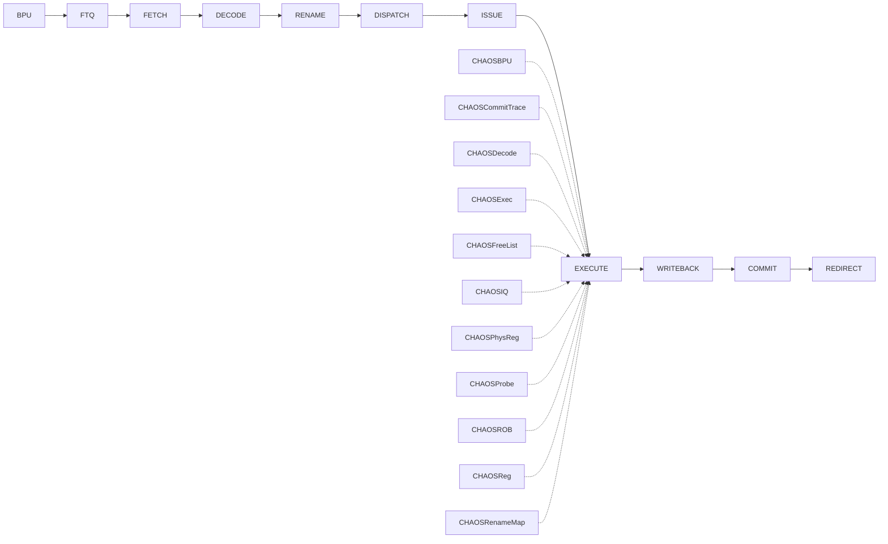

# RET — O3 微架构链路

> 原文：[Branch-RET.md](../../armv8-isa/Branch-RET.md)
> tier: implemented · family: branch-reg

## 一图链路

## 分站链路

| 站点 | 代码锚点 |
|---|---|
| BPU | CHAOS/gem5/src/cpu/o3/bac.cc:565 |
| FTQ | CHAOS/gem5/src/cpu/o3/ftq.cc:186 |
| FETCH | CHAOS/gem5/src/cpu/o3/fetch.cc:1059 |
| DECODE | CHAOS/gem5/src/cpu/o3/decode.cc:636 |
| RENAME | CHAOS/gem5/src/cpu/o3/rename.cc:537 |
| DISPATCH | CHAOS/gem5/src/cpu/o3/iew.cc:881 |
| ISSUE | CHAOS/gem5/src/cpu/o3/inst_queue.cc:868 |
| EXECUTE | CHAOS/gem5/src/cpu/o3/iew.cc:1138 |
| WRITEBACK | CHAOS/gem5/src/cpu/o3/iew.cc:1380 |
| COMMIT | CHAOS/gem5/src/cpu/o3/commit.cc:1125 |
| REDIRECT | CHAOS/gem5/src/cpu/o3/fetch.cc:711 |

## 解码身份

- decoder 格式：ret
- StaticInst 类：Ret64
- 解码锚点：CHAOS/gem5/src/arch/arm/isa/formats/aarch64.isa:771

## 队列与执行单元

- 队列：IQ · FU：IntALU

## CHAOS 注入器命中

| 注入器 |
|---|
| CHAOSBPU |
| CHAOSCommitTrace |
| CHAOSDecode |
| CHAOSExec |
| CHAOSFreeList |
| CHAOSIQ |
| CHAOSPhysReg |
| CHAOSProbe |
| CHAOSROB |
| CHAOSReg |
| CHAOSRenameMap |

## 证据

| 断言 | 锚点 |
|---|---|
| A64 解码树 return new Ret64(...)；family=branch-reg 骨架引用（分类任务深填） | CHAOS/gem5/src/arch/arm/isa/formats/aarch64.isa:771 |
