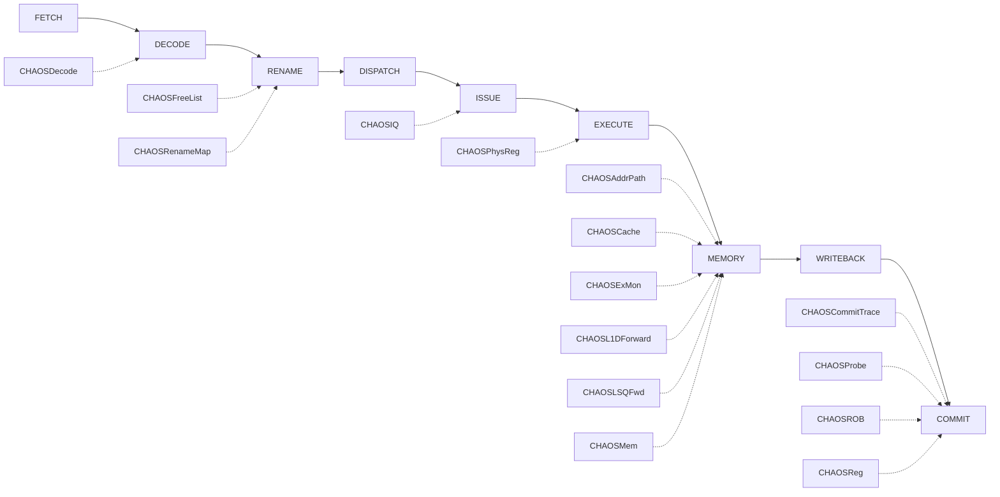

# STLXRB — O3 微架构链路

> 原文：[Load-Store-STLXRB.md](../../armv8-isa/Load-Store-STLXRB.md)
> tier: implemented · family: exclusive

## 一图链路

## 分站链路

| 站点 | 代码锚点 |
|---|---|
| FETCH | CHAOS/gem5/src/cpu/o3/fetch.cc:1059 |
| DECODE | CHAOS/gem5/src/cpu/o3/decode.cc:636 |
| RENAME | CHAOS/gem5/src/cpu/o3/rename.cc:537 |
| DISPATCH | CHAOS/gem5/src/cpu/o3/iew.cc:1015 |
| ISSUE | CHAOS/gem5/src/cpu/o3/inst_queue.cc:868 |
| EXECUTE | CHAOS/gem5/src/cpu/o3/lsq_unit.cc:642 |
| MEMORY | CHAOS/gem5/src/cpu/o3/lsq_unit.cc:1376 |
| WRITEBACK | CHAOS/gem5/src/cpu/o3/lsq_unit.cc:1136 |
| COMMIT | CHAOS/gem5/src/cpu/o3/commit.cc:1125 |

## 解码身份

- decoder 格式：stlxrb
- StaticInst 类：STLXRB64
- 解码锚点：CHAOS/gem5/src/arch/arm/isa/formats/aarch64.isa:1407

## 队列与执行单元

- 队列：LSQ · FU：MemReadOp

## CHAOS 注入器命中

| 注入器 |
|---|
| CHAOSAddrPath |
| CHAOSCache |
| CHAOSCommitTrace |
| CHAOSDecode |
| CHAOSExMon |
| CHAOSFreeList |
| CHAOSIQ |
| CHAOSL1DForward |
| CHAOSLSQFwd |
| CHAOSMem |
| CHAOSPhysReg |
| CHAOSProbe |
| CHAOSROB |
| CHAOSReg |
| CHAOSRenameMap |

## 证据

| 断言 | 锚点 |
|---|---|
| A64 解码树 return new STLXRB64(...)（主定义类，变体见 variants；链路骨架=family exclusive，注入器命中见 injectors） | CHAOS/gem5/src/arch/arm/isa/formats/aarch64.isa:1407 |
