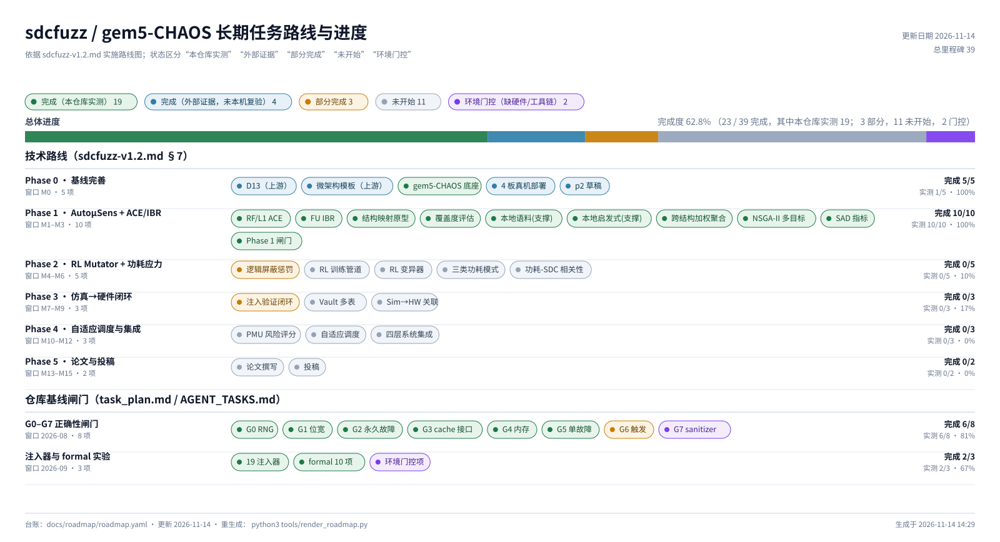

# sdcfuzz / gem5-CHAOS 长期任务路线与进度

> 依据 sdcfuzz-v1.2.md 实施路线图；状态区分“本仓库实测”“外部证据”“部分完成”“未开始”“环境门控”

- 更新日期：2026-11-15
- 总进度：**74.4%**（完成 28/39，其中本仓库实测 24；部分 2，未开始 7，门控 2）



## 状态图例

- `done-local` — 完成（本仓库实测）
- `done-external` — 完成（外部证据，未本机复验）
- `partial` — 部分完成
- `todo` — 未开始
- `gated` — 环境门控（缺硬件/工具链）

## 里程碑明细

### 技术路线（sdcfuzz-v1.2.md §7）

#### Phase 0 · 基线完善（M0，100%）

| 里程碑 | 状态 | 证据 / 缺口 |
|---|---|---|
| D13 操作数启发式（上游 sdcfuzz 实现） | `done-external` | 上游 707db35d 原样同步到 sdcfuzz/upstream/d13/（sha256 4143a4…/fb461f…）；本地 golden、确定性、gem5 基线与单次 FI 冒烟通过；完整 4×100 复现见 docs/sdcfuzz/d13-baseline-reproduction.md |
| 上游 seeds/*.S 微架构模板（方案写 19，实测 20） | `done-external` | 上游 seeds/*.S 实际 20 个、覆盖 8 个模块（E/V/M/C/O/I/L/F）；上游 2026-09-03 合规评估已指出 scheme 的 19/7 口径过时；本仓库无副本，未逐条复验 |
| gem5-CHAOS 注入底座 + 生成→注入闭环 | `done-local` | 19 注入器；CHAOSReg 注入 1 次并分类 Masked（m5out/sdcfuzz-baseline） |
| 4 板 446 核 Kunpeng 920 真机部署 | `done-external` | sdcfuzz-v1.2.md §4.2 历史证据；本机无该硬件，未复验 |
| sdcfuzz 论文 p2 草稿 | `done-external` | 外部 sdcfuzz 仓库；本仓库无副本，未复验 |

#### Phase 1 · AutoµSens + ACE/IBR（M1–M3，100%）

| 里程碑 | 状态 | 证据 / 缺口 |
|---|---|---|
| RF ACE 与 L1 cache ACE 量化 | `done-local` | CHAOS/gem5/src/cpu/o3/rf_ace.*（整数 + 向量/FP 低 64 位）、mem/cache/l1_ace.*；test-rf/l1-ace.sh 在原生 aarch64 + gem5-deps 环境通过；19 模板覆盖矩阵 |
| FU IBR 输入位覆盖率 | `done-local` | CHAOS/gem5/src/cpu/o3/fu_ibr.*（intAlu/intMult/intDiv + fpAdd/fpMult/fpDiv）；test-fu-ibr.sh 在原生 aarch64 通过；19 模板覆盖矩阵 |
| AutoµSens 指令→结构映射与逆向靶向原型 | `done-local` | tools/autousens.py；16 条指令探针/9 结构；targetability 噪声底拒绝 l1i；scripts/test-autousens.py 对 8 个可靶向结构逐一真实验证 |
| 结构覆盖度评估工具 | `done-local` | sdcfuzz/coverage.py（含 target 指标契约）+ sdcfuzz/coverage_report.py（JSON/CSV/Markdown + SAD 占用）+ scripts/test-template-coverage.py；19 模板 9/9 结构真实激活 |
| 本地 19 条结构语料（支撑件，非上游 19 模板） | `done-local` | sdcfuzz/templates.py；19/19 PASS；fp-add/fp-mul 已由 fpadd/fpmul IBR + 向量 ACE 测量；docs/sdcfuzz/phase0-baseline.md 明示非对等复刻 |
| 本地操作数启发式（非上游 D13，仅作可选对照） | `done-local` | sdcfuzz/operand_heuristic.py；tests/test_sdcfuzz_operand_heuristic.py（15 项单测） |
| 跨结构加权聚合靶向（归一化 + 贪心组合） | `done-local` | tools/autousens.py target --structure l1d,alu；按每指令归一化；scripts/test-autousens.py 真实验证 l1d+alu 双结构净激活 |
| NSGA-II 多目标序列集生成 | `done-local` | tools/nsga2.py（确定性 NSGA-II）+ tools/autousens.py pareto；scripts/test-autousens.py 真实 gem5 knee 验证（size=8–14） |
| SAD 结构激活深度指标 | `done-local` | CHAOS/gem5/src/cpu/o3/sad.*（ROB/IQ/LQ/SQ/intPrf/vecPrf/FU/issue）；scripts/test-sad.sh；autousens --sad 与 coverage_report --sad-run 已接入 |
| Phase 1 一键验收（9 步） | `done-local` | scripts/test-phase1.sh（9 步；HEAD 1fdf8cdf 复跑 9/9）+ scripts/verify-phase1.py（10 里程碑台账 10/10）；证据 m5out/phase1-gate-20261114-final/{phase1_gate.json,phase1_milestones.json} |

#### Phase 2 · RL Mutator + 功耗应力（M4–M6，100%）

| 里程碑 | 状态 | 证据 / 缺口 |
|---|---|---|
| 逻辑屏蔽惩罚（雪崩测试） | `done-local` | sdcfuzz/avalanche.py（输入扰动 + 瞬态 + 稳态 pre-roll）；19 模板 40 迭代 m5out/phase2-avalanche/avalanche.json（penalty 0.000–1.000，>0.5 5 条、<0.5 11 条）；7 项单测 |
| RL 训练管道 | `done-local` | sdcfuzz/rl.py（1 层 2 头 Transformer 状态 + 9 维实测/代理覆盖 + 4 维功耗 + 3 维屏蔽；32×10 策略，REINFORCE）；200 轮 m5out/phase2-rl/{training.json,policy.json}，trained_mean −3.027 vs baseline −5.011；6 项单测 |
| RL 引导的指令/操作数/序列变异 | `done-local` | 四类动作 replace 738 / operand 365 / power 71 / recombine 26；最优 FP 流 CHAOSFPU 验证 m5out/phase2-rl/validation.json（fadd 14/20 vs fp-add 17/20，Fisher p=0.451）；代理从 fdiv 1/20 修正到 fadd 14/20 的过程见 docs/sdcfuzz/phase2-verification.md §3 |
| Type-I/II/III 功耗应力模式生成 | `done-local` | sdcfuzz/power.py；9 条流 × gem5 + McPAT（pypat arm64-kunpeng920，9/9 ok，动态功耗 31.14–38.55 W）；m5out/phase2-power/{streams.json,power_measurements.json}；6 项单测 |
| 功耗-SDC 相关性（Pearson/Spearman） | `done-local` | sdcfuzz/power_sdc.py；6 条 FP 流 ×20 次 CHAOSFPU；H1 proxy peak r=+0.962 (p=0.098) 但 McPAT r=−0.412 (p=0.461)；H2 Δ=0 (p=1)；H3 Δ=+0.025 (p=1)；m5out/phase2-power/correlation.{json,md}；H1–H3 未获支持，边界见 phase2-verification.md §5/§7 |

#### Phase 3 · 仿真→硬件闭环（M7–M9，17%）

| 里程碑 | 状态 | 证据 / 缺口 |
|---|---|---|
| gem5 故障注入验证闭环（多注入器 × 语料） | `partial` | 19 注入器 + classify.py + 1 次闭环冒烟；语料级批量 campaign 未做 |
| Vault 持久库 + 血缘 | `todo` |  |
| 仿真预测与实机 SDC 的统计关联 | `todo` | 需实机数据；本机不可得（见 gated 项） |

#### Phase 4 · 自适应调度与集成（M10–M12，0%）

| 里程碑 | 状态 | 证据 / 缺口 |
|---|---|---|
| PMU 采集 + SDC 风险评分 | `todo` |  |
| 负载感知的自适应调度 | `todo` |  |
| 四层系统集成 | `todo` |  |

#### Phase 5 · 论文与投稿（M13–M15，0%）

| 里程碑 | 状态 | 证据 / 缺口 |
|---|---|---|
| 论文撰写（三项创新点） | `todo` |  |
| 投稿准备与提交 | `todo` |  |

### 仓库基线闸门（task_plan.md / AGENT_TASKS.md）

#### G0–G7 正确性闸门（2026-08，81%）

| 里程碑 | 状态 | 证据 / 缺口 |
|---|---|---|
| 可复现 RNG（20/20 重放一致） | `done-local` | commit 3b8c33c |
| 64 位掩码 / 合法域 | `done-local` | commit 54f31cd |
| 永久/间歇语义（stuck 掩码） | `done-local` | commit e5eecbb |
| cache 安全访问接口 | `done-local` | commit ea6b192 |
| CHAOSMem 权重与边界正确性 | `done-local` | commit 9870e9f |
| 单故障 + 证据日志（maxFaults） | `done-local` | commit d44982f |
| 触发间隔与多触发模式 | `partial` | ≥1 cycle 间隔已做；pc/committedInst/event 多触发未做（D9） |
| ASan/UBSan 工具构建 | `gated` | scons socket configure 受阻（D10）；解锁：CI 层修复 |

#### 注入器与 formal 实验（2026-09，67%）

| 里程碑 | 状态 | 证据 / 缺口 |
|---|---|---|
| 19 个 CHAOS 注入器 | `done-local` | AGENT_TASKS.md S1-* 全 done |
| n=384 批量 formal 实验（10 任务） | `done-local` | task_plan.md Phase 3（853133cb…） |
| S4/S6/S7/ExMon/Decode/O3-switch 登记 | `gated` | task_plan.md Phase 7（deferred，含解锁条件） |

## 维护方式

1. 修改 `docs/roadmap/roadmap.yaml`（状态取值见文件头注释）。
2. 重新生成：`python3 tools/render_roadmap.py`。
3. 需要 PNG 时：

```bash
inkscape docs/roadmap/roadmap.svg --export-type=png \
  --export-filename=docs/roadmap/roadmap.png
```
